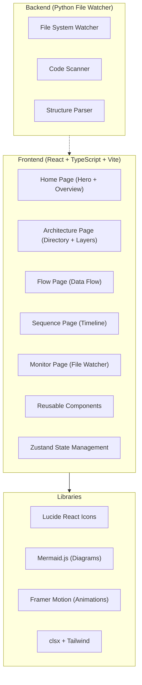

# NeuralAgent 可视化架构网站 - 技术架构文档

## 1. Architecture Design



## 2. Technology Description

- **Frontend**: React@18 + TypeScript + Vite + Tailwind CSS
- **Initialization Tool**: vite-init
- **Backend**: Python (file watcher and scanner, optional)
- **Diagram Library**: Mermaid.js for architecture diagrams
- **State Management**: Zustand for local state
- **Icons**: Lucide React
- **Animations**: Framer Motion
- **Styling**: Tailwind CSS v3 with glass-morphism design

## 3. Route Definitions

| Route | Purpose |
|-------|---------|
| / | Home page with system overview |
| /architecture | Architecture diagrams, directory tree, layer details |
| /flow | Data flow and agent workflow visualizations |
| /sequence | Sequence diagrams for core functionality |
| /monitor | Real-time file watcher and auto-update status |

## 4. Project Structure

```
/workspace/neural_agent/arch-visualization/
├── src/
│   ├── components/
│   │   ├── Layout/                  # 布局组件
│   │   ├── Navigation/              # 导航栏
│   │   ├── Architecture/            # 架构图组件
│   │   ├── Flow/                    # 流程图组件
│   │   ├── Sequence/                # 时序图组件
│   │   └── Monitor/                 # 监控组件
│   ├── pages/
│   │   ├── Home.tsx
│   │   ├── Architecture.tsx
│   │   ├── Flow.tsx
│   │   ├── Sequence.tsx
│   │   └── Monitor.tsx
│   ├── hooks/
│   │   ├── useFileWatcher.ts        # 文件监听钩子
│   │   └── useCodeScanner.ts        # 代码扫描钩子
│   ├── utils/
│   │   └── mermaid.ts               # Mermaid 工具函数
│   ├── store/
│   │   └── useAppStore.ts           # Zustand 状态管理
│   └── App.tsx
├── public/
├── watcher/                         # Python 文件监控
│   └── file_watcher.py
└── package.json
```

## 5. Key Technical Components

### 5.1 React Component Structure
- **Layout**: Responsive sidebar + content layout
- **Navigation**: Fixed header with animated menu
- **Architecture Components**: Tree view, grid view, detail panels
- **Flow Components**: Animated flowcharts, connection lines
- **Sequence Components**: Mermaid.js integration, timeline views

### 5.2 State Management (Zustand)
```typescript
interface AppState {
  currentRoute: string;
  projectStructure: any;
  fileChanges: string[];
  setRoute: (route: string) => void;
  updateStructure: (data: any) => void;
  addFileChange: (file: string) => void;
}
```

### 5.3 File Watcher (Python)
Uses `watchdog` library to monitor file changes in the project directory and send updates via WebSocket or API.

### 5.4 Diagram Rendering
- **Mermaid.js integration** for architecture, flow, and sequence diagrams
- **Custom React components** for interactive layer visualization
- **Framer Motion** for smooth animations and transitions

## 6. UI Component Breakdown

### 6.1 Layout Components
- `Sidebar`: Collapsible navigation with icons
- `Header`: Logo, page title, theme toggle
- `GridLayout`: Responsive grid for card layouts

### 6.2 Architecture Components
- `DirectoryTree`: Interactive file browser
- `NeuralLayersGrid`: 18-layer neural network visualization
- `ModuleDependencyGraph`: Interactive dependency diagram

### 6.3 Flow Components
- `DataFlowChart`: Animated data through layers
- `AgentWorkflow`: Complete processing pipeline

### 6.4 Sequence Components
- `MermaidDiagram`: General-purpose Mermaid renderer
- `TimelineViewer`: Horizontal timeline with details

### 6.5 Monitor Components
- `FileChangeMonitor`: Real-time file changes
- `AutoUpdateStatus`: Watcher status and controls

## 7. Styling Approach

- **Dark theme by default** with glass-morphism
- **Tailwind CSS** for utility-first styling
- **Framer Motion** for entrance and interaction animations
- **CSS variables** for consistent theming
- **Responsive design** for all screen sizes

