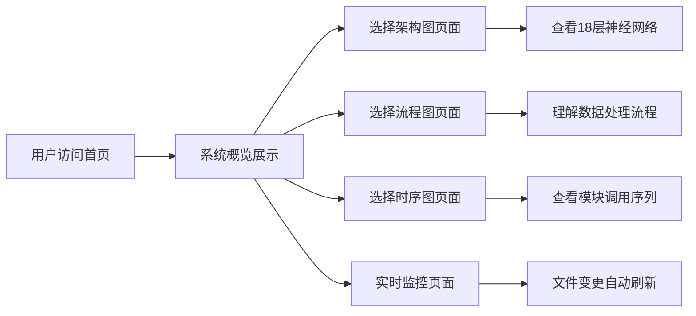

# NeuralAgent 可视化架构网站 - 产品需求文档

## 1. Product Overview

NeuralAgent 架构可视化网站是一个交互式的、美观的系统架构展示平台，将复杂的 AI Agent 系统架构通过可视化图表清晰地呈现给开发者和用户。

- **主要目的**: 让用户直观了解 NeuralAgent 的 18 层神经网络架构、核心模块和工作流程
- **目标用户**: 开发者、研究人员、对 AI Agent 感兴趣的用户
- **市场价值**: 降低系统理解门槛，提升产品专业度

## 2. Core Features

### 2.1 User Roles
| Role | Registration Method | Core Permissions |
|------|---------------------|------------------|
| General User | No login required | View all diagrams and architecture information |

### 2.2 Feature Module
1. **首页 (Home)**: 系统概览、Hero 动画、快速导航
2. **架构图 (Architecture)**: 完整的系统架构图、模块关系、目录结构
3. **流程图 (Flow)**: 18层神经网络流程图、数据处理流程
4. **时序图 (Sequence)**: 核心功能调用时序、模块交互
5. **实时监控 (Monitor)**: 文件变更监控、自动更新机制

### 2.3 Page Details
| Page Name | Module Name | Feature description |
|-----------|-------------|---------------------|
| Home | Hero section | Animated neural network particles, system stats, quick access buttons |
| Home | System overview | Brief introduction, core modules display, key metrics |
| Architecture | Directory tree | Interactive file browser with real-time updates |
| Architecture | System layers | 18-layer neural network visualization with details |
| Architecture | Module relationships | Interactive diagram showing module dependencies |
| Flow | Data process | Animated flow of data through the neural layers |
| Flow | Agent workflow | Complete workflow from input to output |
| Sequence | Memory sequence | Memory storage and retrieval sequence diagram |
| Sequence | LLM integration | LLM call and processing sequence |
| Monitor | File watcher | Real-time file change detection and auto-refresh |

## 3. Core Process

用户访问网站 → 查看系统概览 → 浏览架构图 → 查看流程图 → 理解时序图 → 监控文件变更

## 4. User Interface Design

### 4.1 Design Style
- **Primary color**: 深科技蓝 (#0F172A) + 渐变紫 (#7C3AED)
- **Secondary color**: 亮青色 (#06B6D4) + 荧光绿 (#10B981)
- **Button style**: 圆角玻璃拟态，悬浮发光效果
- **Font family**: 主标题用 Geist Mono, 内容用 Geist Sans
- **Layout style**: 现代卡片式布局，网格加错落排列
- **Icon style**: Lucide 图标库，带霓虹边缘效果

### 4.2 Page Design Overview
| Page Name | Module Name | UI Elements |
|-----------|-------------|-------------|
| Home | Hero section | 3D neural particle background, glass cards, animated gradient |
| Architecture | Directory tree | Collapsible file browser with syntax highlighting |
| Architecture | Layer diagram | Interactive grid with hover effects and detail panels |
| Flow | Process flow | Vertical animated flow with connection lines |
| Sequence | Timeline | Interactive horizontal timeline with Mermaid diagrams |

### 4.3 Responsiveness
- **Desktop-first design**, 1920x1080 最佳体验
- **Tablet support**, 自适应网格布局
- **Mobile optimization**, 单列垂直排列，触摸友好
- **Touch gestures support**, 缩放、拖拽等交互

### 4.4 Visual Effect Guidance
- **Background**: Dark theme with subtle noise texture and mesh gradient
- **Cards**: Glass morphism with backdrop blur and subtle border glow
- **Animations**: Staggered reveal, smooth transitions, scroll-triggered effects
- **Typography**: Clear hierarchy with monospace for code, sans-serif for content
- **Interactions**: Hover scale effects, click animations, scroll parallax

