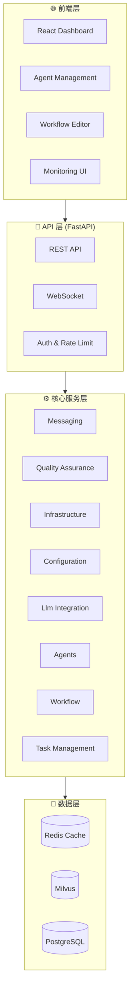

# NeuralAgent - 企业级 AI Agent 平台

> 🧠 完整的企业级 AI Agent 平台，支持多 Agent 协作、记忆系统、RAG 检索、工作流编排

## 📊 项目统计


| 指标 | 数值 |
|------|------|
| Python 文件 | 85 |
| TypeScript 文件 | 19 |
| 测试文件 | 37 |
| 总代码行数 | 27,046 |
| 核心模块数 | 20 |
| 最后更新 | 2026-05-16 14:56:01 |


## 🎯 核心功能

- ✅ **Agent 框架** - 多 Agent 协作和任务调度
- ✅ **记忆系统** - 统一记忆、分层存储
- ✅ **RAG 系统** - 检索增强生成
- ✅ **工作流引擎** - 可视化工作流编排
- ✅ **监控系统** - Prometheus + Grafana
- ✅ **安全系统** - JWT + MFA + OAuth

## 🚀 快速开始

```bash
# 克隆项目
git clone <repository-url>
cd neural_agent

# 启动服务
docker-compose up -d

# 访问界面
# 前端: http://localhost:3001
# 后端: http://localhost:8000
# API 文档: http://localhost:8000/docs
```

## 📁 项目结构

```
neural_agent/
├── backend/               # 后端服务
│   └── core/            # 核心模块
│       ├── agents/       # Agent 框架
│       ├── memory/       # 记忆系统
│       ├── workflow/     # 工作流引擎
│       ├── rag/          # RAG 系统
│       ├── vector_store/ # 向量存储
│       └── monitoring/   # 监控系统
├── frontend/             # 前端应用
│   └── src/
│       ├── pages/       # 页面组件
│       └── components/  # UI 组件
├── tests/               # 测试文件
└── docs/                # 文档
```

## 📈 系统架构





## 🔧 核心模块

| 模块 | 功能 | 状态 |
|------|------|------|
| Messaging | 3 个文件 | ✅ |
| Quality Assurance | 4 个文件 | ✅ |
| Infrastructure | 16 个文件 | ✅ |
| Configuration | 3 个文件 | ✅ |
| Llm Integration | 3 个文件 | ✅ |
| Agents | 4 个文件 | ✅ |
| Workflow | 2 个文件 | ✅ |
| Task Management | 2 个文件 | ✅ |
| Neural Layers | 17 个文件 | ✅ |
| I18N | 2 个文件 | ✅ |
| Rag | 2 个文件 | ✅ |
| Vector Store | 3 个文件 | ✅ |
| Memory | 6 个文件 | ✅ |
| Optimization | 1 个文件 | ✅ |
| Plugins | 2 个文件 | ✅ |
| Trust Management | 2 个文件 | ✅ |
| Security | 7 个文件 | ✅ |
| Monitoring | 3 个文件 | ✅ |
| Observability | 1 个文件 | ✅ |
| Cache | 2 个文件 | ✅ |

## 📚 文档

- [可视化文档](docs/index.html) - 包含架构图、流程图、时序图
- [部署指南](DEPLOYMENT_GUIDE.md) - 完整部署文档
- [优化报告](OPTIMIZATION_REPORT.md) - 性能优化建议

## 🧪 测试

```bash
# 运行所有测试
python tests/test_comprehensive.py

# 运行性能测试
python benchmarks/performance.py
```

## 🤝 贡献

欢迎提交 Issue 和 Pull Request！

## 📄 许可证

MIT License

---

**版本**: 1.0.0  
**最后更新**: 2026-05-16
